# ACE-Net: a pure-NumPy deep learning stack (Team ACE, Option A)

ACE-Net is a from-scratch deep learning stack written only in NumPy. It has a `Tensor` with reverse-mode autograd, layers, losses, optimizers, a training loop with run logging, an int8 post-training quantizer with an integer-only inference engine, distribution-shift tooling and knowledge distillation. Everything is trained and evaluated on Fashion-MNIST. There is no AD library, no scipy and no sklearn (`tests/test_repo.py` enforces this). Every number in the tables below is generated from `runs/*.json` by `python -m scripts.make_tables`, so the README cannot drift from the logged runs. The val split (6,000 images, seed 0) is used for every decision. Each final model sees the test set once.

## Requirements checklist

<!-- table:checklist -->
| tier | requirement | result | evidence |
|---|---|---|---|
| Core | Tensor + reverse-mode autograd (graph, topo sort, broadcasting) | 27 ops gradchecked, worst rel. err 1.5e-09 (tol 1e-05); 147 tests pass | `acenet/tensor.py`, `tests/test_autograd.py`, `runs/gradcheck.json` |
| Core | Layers, losses, optimizers (Linear/Conv/BN/Pool/Dropout; CE; SGD-momentum, Adam/AdamW) | all gradchecked or unit-tested | `acenet/{ops,nn,optim}.py`, `tests/` |
| Core | MLP on Fashion-MNIST with train/val curves | test 0.8916 (Adam), 0.8880 (SGD) | `runs/mlp_test.json`, `experiments/figures/mlp_sgd_vs_adam.png` |
| Core | Failure case analysed and fixed | overfit + divergence diagnosed and fixed | `docs/failure.md`, `runs/mlp_overfit_diagnosis.json` |
| Advanced | CNN (conv/pool/BN) with augmentation | E2 test 0.9403 (flip TTA), A 0.9325 (no TTA) | `runs/test_once.json`, `runs/cnn_test.json` |
| Advanced | int8 post-training quantization, integer-only inference | E2 int8 test 0.9399 (-0.04 pt), 3.9x smaller | `acenet/quant.py`, `runs/cnn_{b,e2,d}_int8.json` |
| Advanced | Robustness to distribution shift | D shifted val 0.910 vs E2 0.671 | `docs/robustness.md`, `runs/robustness.json` |
| Bonus | Knowledge distillation into a <= 50 KB int8 student | S1 (KD) int8 test 0.9287; S0 (CE, selected) 0.9281; both 43,770 B; criterion >= 0.9203: pass | `runs/distill.json`, `docs/ablation.md` |
| Bonus | LR finder + cosine warmup schedule | cosine warmup +0.52 pt val+TTA | `runs/lr_finder.json`, `runs/lr_finder.png` |
| Bonus | Hidden-set evaluator (npz / idx / PNG, any size) | self-test pass on 6,000 images, 8 models | `experiments/hidden_eval.py`, `runs/hidden_eval_selftest.json` |
| Repro | Fresh-clone smoke test of every experiment | pass: 35 steps in 8.0 min | `scripts/smoke_test.py`, `runs/smoke_test.json` |
<!-- /table:checklist -->

## Quickstart

```bash
python3.12 -m venv .venv && .venv/bin/pip install numpy matplotlib pytest
.venv/bin/python -m pytest -q                       # unit tests + gradcheck table (writes runs/gradcheck.json)
.venv/bin/python scripts/smoke_test.py              # fresh clone, download, every stage with --smoke
.venv/bin/python -m experiments.hidden_eval PATH    # evaluate all declared models on a hidden set
.venv/bin/python -m scripts.make_tables             # rebuild every table in this README from runs/*.json
```

Fashion-MNIST is downloaded on first use into `data/raw/` and checked against the expected idx magic numbers and shapes.

<!-- table:env -->
| item | value |
|---|---|
| hardware | Apple M1, 8 cores |
| platform | macOS-14.8.8-arm64-arm-64bit |
| Python | 3.12.15 |
| numpy | 2.5.4 |
| test suite | 147 passed in 5 s |
| smoke test (fresh clone, all steps) | 8.0 min + download 13 s |
<!-- /table:env -->

**One command per experiment.** Run them in this order: each stage reads the JSON its predecessors wrote. Add `--smoke` to any command to run it on fixed tiny subsets (2,048 train / 512 val / 512 test, one epoch per training run). The smoke column is the measured time of that step inside `scripts/smoke_test.py`. "Full run" is the wall time logged by the real run. Evaluation-only stages did not log their wall time.

<!-- table:runtimes -->
| command | full run (measured) | smoke | note |
|---|---|---|---|
| `python -m experiments.show_data` | not logged | 2.1 s |  |
| `python -m experiments.mlp sweep` | 107 s | 1.7 s | 6 x 40 epochs |
| `python -m experiments.mlp failures` | 32 s | 1.0 s |  |
| `python -m experiments.mlp run --tag fix --opt adam --lr 3e-4 --dropout 0.3 --wd 0.05` | 41 s | 0.8 s |  |
| `python -m experiments.mlp test` | not logged | 0.6 s |  |
| `python -m experiments.diagnose_overfit` | 74 s | 1.0 s |  |
| `python -m experiments.cnn train` | 47.2 min | 8.2 s | 20 epochs |
| `python -m experiments.cnn retry` | not logged | 6.8 s |  |
| `python -m experiments.cnn test` | not logged | 1.1 s |  |
| `python -m experiments.cnn shift` | not logged | 2.4 s |  |
| `python -m experiments.cnn ablation` | 92.6 min | 11.5 s |  |
| `python -m experiments.cnn_ablation` | not logged | 6.4 s |  |
| `python -m experiments.quant B` | 31 s | 31.2 s | int8 engine on 10k images only |
| `python -m experiments.robust finder` | 107 s | 5.7 s |  |
| `python -m experiments.robust augspeed` | not logged | 0.8 s |  |
| `python -m experiments.robust train` | 2.4 h | 19.7 s | E1, E2, D: 20 epochs each |
| `python -m experiments.robust eval` | not logged | 17.0 s |  |
| `python -m experiments.robust plot` | not logged | 0.7 s |  |
| `python -m experiments.robust select` | not logged | 0.6 s |  |
| `python -m experiments.distill teachers` | not logged | 58.2 s |  |
| `python -m experiments.distill cache` | 3.3 min | 10.1 s |  |
| `python -m experiments.distill candidates` | not logged | 0.6 s |  |
| `python -m experiments.distill speed` | not logged | 10.4 s |  |
| `python -m experiments.distill screen` | 82.4 min | 40.9 s | 3 finders + 3 x 10 epochs |
| `python -m experiments.distill select_arch` | not logged | 0.6 s |  |
| `python -m experiments.distill cache_cropflip` | 3.1 min | 9.5 s |  |
| `python -m experiments.distill students` | 99.0 min | 50.2 s | S0, S1: 40 epochs each |
| `python -m experiments.distill final` | not logged | 56.0 s |  |
| `python -m experiments.distill deliverable` | not logged | 6.4 s |  |
| `python -m experiments.distill ablation` | not logged | 0.4 s |  |
| `python -m experiments.plots all` | not logged | 1.8 s |  |
| `python -m experiments.hidden_eval --selftest` | not logged | 79.4 s |  |
| `python -m experiments.hidden_eval data/hidden_selftest/idx --name smoke` | not logged | 21.1 s |  |
| `python -m pytest -q -p no:cacheprovider` | not logged | 5.0 s |  |
| `python -m scripts.make_tables` | not logged | 0.0 s |  |
<!-- /table:runtimes -->

## Architecture

```
acenet/tensor.py   Tensor, graph, backward (topological sort), no_grad          layer 0: numpy only
acenet/ops.py      differentiable ops: elementwise, matmul, reductions, conv2d,  layer 1: tensor
                   depthwise_conv2d, maxpool2d, batchnorm, fused softmax-CE, kd_loss
acenet/nn.py       Module, Linear, Conv2D, DepthwiseConv2D, BatchNorm1d/2d,      layer 2: ops, tensor
                   MaxPool2D, GlobalAvgPool2D, ReLU, Dropout, Flatten, Sequential
acenet/optim.py    SGD (momentum, Nesterov), Adam/AdamW, CosineWarmup, lr_finder  layer 2: tensor (data only)
acenet/data.py     download + verify, split, standardize, crop/flip/erase/shift  layer 0: numpy only
                   augmentation, DataLoader, CacheLoader (KD)
acenet/shift.py    rotation / noise / brightness shifts, shifted-val builder     layer 1: data
acenet/train.py    fit(): epochs, per-batch schedule, best-val checkpoint,      layer 3: nn, ops, tensor
                   runs/<name>_<timestamp>/{config.json, seed.txt, metrics.csv, curves.png}
acenet/quant.py    BN folding, calibration, int8 engine, fake-quant, .npz/.ace8  layer 3: nn (float side only)
experiments/*.py   one script per phase; scripts/*.py: tables, smoke test        layer 4: everything above
```

Every random draw comes from an explicit `np.random.Generator`. There are no global `np.random.*` calls. Training is float32, and gradchecks run in float64.

**Autograd design.**
- *Graph.* Every op returns a `Tensor` holding its parents and a closure `_backward(g) -> (g_parent, ...)`. Under `no_grad()` nothing is recorded.
- *Topological sort.* `backward()` runs an iterative post-order DFS, so deep graphs cannot hit the recursion limit (tested on a 5,000-op chain). It then walks the order in reverse. Gradients live in a per-pass table and are summed per node, so a tensor used several times receives the sum of its contributions. Only leaves keep `.grad`.
- *unbroadcast.* Binary ops broadcast like NumPy. Backward sums the gradient over the leading axes NumPy added, and over every axis that was 1 in the input.
- *Fused cross-entropy.* `softmax_cross_entropy` computes the loss with log-sum-exp and returns `(softmax - target) / N` as one node, optionally with label smoothing. It never forms a softmax node and then a log node. `kd_loss` is built from existing ops: the T²-scaled KL term plus CE.
- *Coarse ops.* `conv2d` (im2col + one matmul), `depthwise_conv2d` (offset-sum form), `maxpool2d` (first-argmax routing) and `batchnorm` (closed-form backward) are single graph nodes with hand-written vectorized backward passes. This keeps graphs small and avoids per-pixel Python.

**Gradcheck.** Central differences, float64, eps 1e-6, relative error `‖a−n‖ / (‖a‖+‖n‖)`. Every op is checked on several shapes. The table lists the worst case per op. End-to-end MLP and CNN losses are included.

<!-- table:gradcheck -->
| op | max rel. err | op | max rel. err |
|---|---|---|---|
| add | 6.1e-11 | relu | 7.1e-11 |
| sub | 9.1e-11 | log_softmax | 2.9e-10 |
| neg | 4.8e-11 | softmax_cross_entropy | 7.5e-10 |
| mul | 8.9e-11 | broadcasting | 1.6e-10 |
| div | 4.4e-11 | reused input | 8.7e-11 |
| pow | 2.0e-10 | mlp end-to-end | 7.0e-10 |
| matmul | 3.1e-10 | conv2d | 5.5e-10 |
| sum | 2.6e-10 | maxpool2d | 1.4e-10 |
| mean | 5.9e-11 | batchnorm | 7.5e-10 |
| max | 4.8e-11 | cnn end-to-end | 7.1e-10 |
| reshape | 3.7e-11 | depthwise_conv2d | 4.2e-10 |
| transpose | 7.4e-11 | kd_loss | 1.5e-09 |
| exp | 7.4e-11 | global_avg_pool | 2.7e-10 |
| log | 4.3e-11 |  |  |
<!-- /table:gradcheck -->

## MLP (784-256-128-10)

Six runs sweep the learning rate (SGD-momentum 0.9 and Adam, 3 lrs each, 40 epochs). The best-val config per optimizer is tested once. Two deliberate failure runs follow: an unregularized 60-epoch run that overfits, and SGD at lr 1.0, which diverges and is aborted by the non-finite-loss guard. A dropout + weight-decay run fixes the overfit.

<!-- table:mlp -->
| tag | opt | lr | regularization | epochs | status | best val | best ep | test (once) | time |
|---|---|---|---|---|---|---|---|---|---|
| sweep | sgd | 0.01 | none | 40 | ok | 0.8985 | 35 | 0.8880 | 15 s |
| sweep | sgd | 0.03 | none | 40 | ok | 0.8953 | 24 | – | 14 s |
| sweep | sgd | 0.1 | none | 40 | ok | 0.8908 | 31 | – | 14 s |
| sweep | adam | 0.0003 | none | 40 | ok | 0.8983 | 20 | 0.8916 | 21 s |
| sweep | adam | 0.001 | none | 40 | ok | 0.8982 | 40 | – | 21 s |
| sweep | adam | 0.003 | none | 40 | ok | 0.8955 | 40 | – | 22 s |
| overfit | adam | 0.0003 | none | 60 | ok | 0.8983 | 20 | – | 32 s |
| diverge | sgd | 1 | none | 40 | diverged | – | – | – | 0 s |
| fix | adam | 0.0003 | dropout 0.3, wd 0.05 | 60 | ok | 0.9040 | 57 | – | 41 s |
<!-- /table:mlp -->

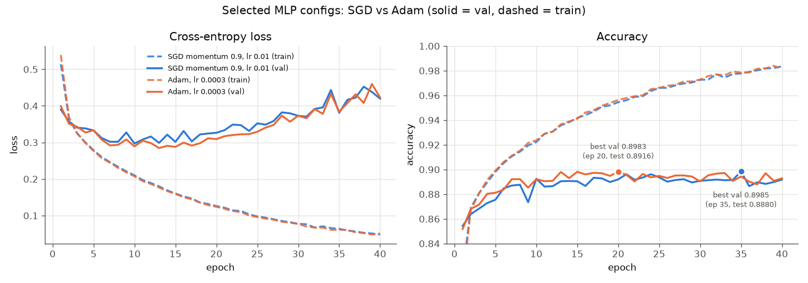

**Failure analysis** ([docs/failure.md](docs/failure.md)). Val loss climbs while val accuracy stays flat. The cause is that the loss becomes dominated by a growing set of confidently wrong predictions, as the weight norm and logit range grow. Accuracy barely moves. The fix (dropout 0.3, weight decay 0.05) keeps val loss flat and improves best val. Both runs were re-run with the same seeds and reproduced `metrics.csv` exactly before the comparison below.

<!-- table:mlp_failure -->
|  | overfit @ best ep 20 | overfit @ ep 60 | fix @ best ep 57 | fix @ ep 60 |
|---|---|---|---|---|
| val acc | 0.8983 | 0.8898 | 0.9040 | 0.9012 |
| val NLL | 0.3090 | 0.5826 | 0.2832 | 0.2913 |
| # wrong | 610 | 661 | 576 | 593 |
| loss share from wrong | 83.3% | 97.0% | 82.2% | 84.1% |
| mean confidence when wrong | 0.7303 | 0.8584 | 0.7126 | 0.7230 |
| wrong with conf > 0.99 | 4.8% | 30.0% | 5.2% | 5.9% |
| weight L2 norm | 33.3 | 41.5 | 31.3 | 31.4 |
<!-- /table:mlp_failure -->

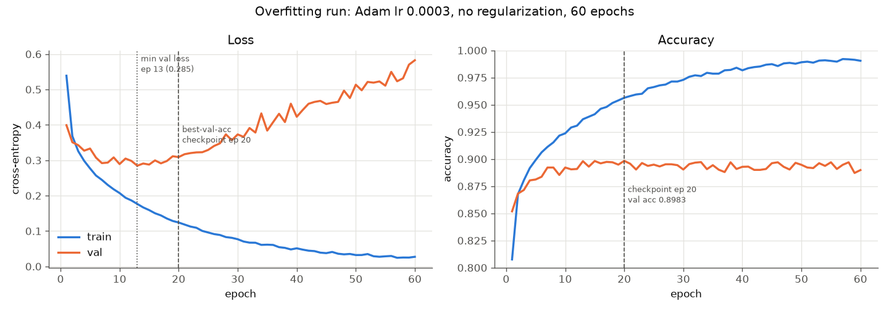 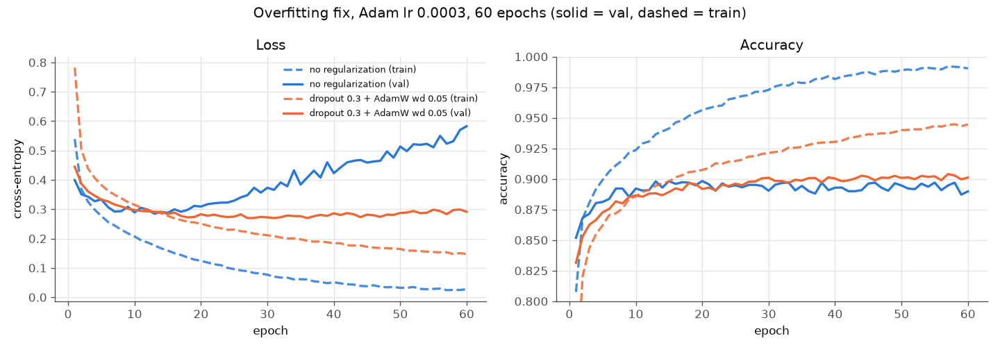 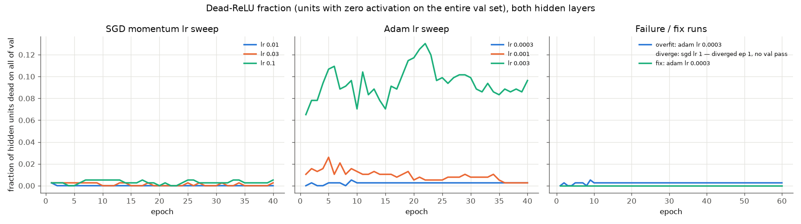

## CNN

Architecture: conv 32-32 → pool → conv 64-64 → pool → fc 128 → fc 10, with BN + ReLU after every conv and after fc 128, and dropout 0.3 before each fc layer (468k params). Training uses AdamW (wd 5e-4), batch 128, 20 epochs and random crop (pad 2) + horizontal flip. "TTA" means the mean of the softmaxes of x and hflip(x).

<!-- table:cnn -->
| id | recipe | best ep | val | val+TTA | test (once) | ECE | train time |
|---|---|---|---|---|---|---|---|
| A | baseline (Phase 3 selected) | 20 | 0.9362 | 0.9393 | 0.9325 (no TTA) | 0.0066 | 47.2 min |
| B | A + random erasing | 19 | 0.9377 | 0.9398 | 0.9349 | 0.0066 | 50.7 min |
| C | B + label smoothing 0.1 | 20 | 0.9360 | 0.9383 | – | 0.0848 | 41.9 min |
| E1 | A + finder lr, constant | 20 | 0.9387 | 0.9398 | – | 0.0087 | 44.6 min |
| E2 | A + finder lr + CosineWarmup(1 ep) | 18 | 0.9448 | 0.9450 | 0.9403 | 0.0043 | 59.5 min |
| D | B + shift aug + finder lr + CosineWarmup(1 ep) | 20 | 0.9360 | 0.9368 | 0.9278 | 0.0129 | 42.1 min |
<!-- /table:cnn -->

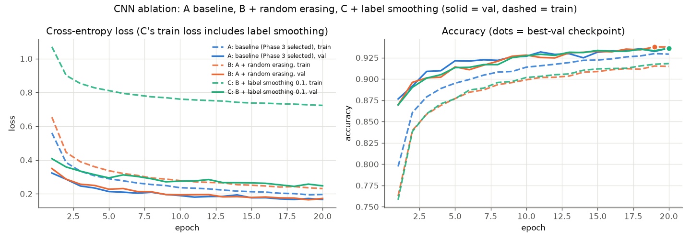

**Augmentation / label smoothing findings.**
- Random erasing (B) is nearly free on clean val but is the largest single robustness gain without shift augmentation (see Robustness).
- Label smoothing 0.1 (C) lowers val+TTA and makes calibration about an order of magnitude worse (ECE column), because the smoothed targets make the model under-confident. It was rejected.
- The LR finder + cosine warmup recipe (E2) gives the best clean model.

**Per-class accuracy (val, TTA).** Shirt is the hardest class for every model. It is confused with T-shirt/top, Pullover and Coat.

<!-- table:per_class -->
| class (val+TTA) | A | B | C | E2 | D | S0 |
|---|---|---|---|---|---|---|
| T-shirt/top | 0.875 | 0.905 | 0.839 | 0.894 | 0.889 | 0.875 |
| Trouser | 0.982 | 0.984 | 0.984 | 0.982 | 0.984 | 0.980 |
| Pullover | 0.865 | 0.896 | 0.898 | 0.915 | 0.886 | 0.891 |
| Dress | 0.957 | 0.957 | 0.953 | 0.965 | 0.933 | 0.945 |
| Coat | 0.941 | 0.911 | 0.901 | 0.926 | 0.923 | 0.933 |
| Sandal | 0.980 | 0.987 | 0.992 | 0.982 | 0.990 | 0.992 |
| Shirt | 0.823 | 0.800 | 0.858 | 0.824 | 0.799 | 0.816 |
| Sneaker | 0.990 | 0.984 | 0.979 | 0.982 | 0.986 | 0.970 |
| Bag | 1.000 | 0.995 | 0.998 | 0.997 | 0.993 | 0.990 |
| Ankle boot | 0.977 | 0.975 | 0.980 | 0.980 | 0.982 | 0.973 |
<!-- /table:per_class -->

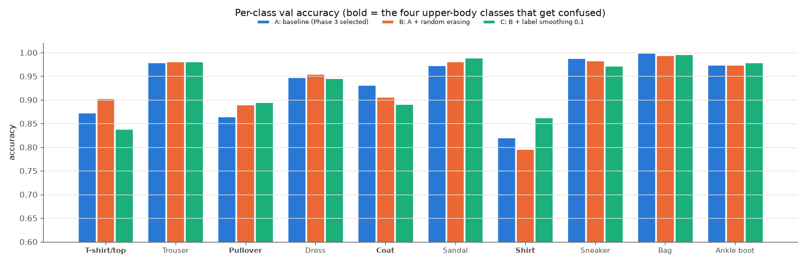 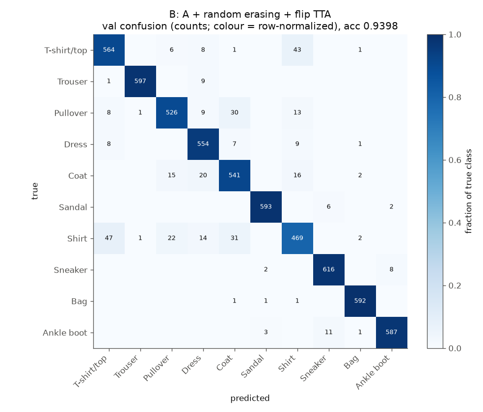

## int8 post-training quantization

**Scheme** (`acenet/quant.py`):
- *Symmetric, zero-point 0.* int8 range [−127, 127].
- *Per-output-channel weight scales.* Activations use per-tensor scales, calibrated on 2,000 clean **train** images. The calibrator is the 99.99th percentile of |x|, chosen over min/max on val in Phase 4.
- *BN folding.* Each BN is folded into the preceding conv/linear (W' = γW/σ, b' = γ(b−μ)/σ + β). The folded float model is checked to give identical predictions.
- *Integer-only engine.* The input is quantized once at the model boundary. After that the engine runs int8 × int8 → int32 accumulate (with an accumulator-bound check), adds the int32 bias at scale s_in·s_w, and requantizes to int8 with a **fixed-point multiplier** (M0 in Q31 + right shift, round half up, via int64). ReLU and max-pool run on int8, and global-average-pool is an integer sum with round-half-up.
- *Final layer: common-scale rescale.* The last layer does not requantize to int8. Its int32 accumulators are rescaled per class by M = s_w[c] / max(s_w), so all ten logits share one scale and argmax is exact. Flip TTA sums the int32 logits.
- *Formats.* Teachers use `.npz`. Students use the compact `.ace8` binary (56-byte header + raw arrays), whose file size is the deployed size and is checked against the 50,000-byte budget.

<!-- table:int8 -->
| model | float val+TTA | int8 val+TTA | float test | int8 test | Δ test (pt) | int8 = float pred. (val) | int8 file |
|---|---|---|---|---|---|---|---|
| B | 0.9398 | 0.9387 | 0.9349 | 0.9344 | -0.05 | 0.9975 | 466.9 KB |
| E2 | 0.9450 | 0.9447 | 0.9403 | 0.9399 | -0.04 | 0.9960 | 466.9 KB |
| D | 0.9368 | 0.9370 | 0.9278 | 0.9282 | +0.04 | 0.9977 | 466.9 KB |
| S0 | 0.9367 | 0.9337 | 0.9304 | 0.9281 | -0.23 | 0.9807 | 43,770 B |
| S1 | 0.9337 | 0.9323 | 0.9299 | 0.9287 | -0.12 | 0.9840 | 43,770 B |
<!-- /table:int8 -->

Size breakdown of the B int8 file and the student (bytes):

<!-- table:int8_size -->
| layer | int8 W | int32 b | int32 M0 | int8 shift | bytes | float32 bytes |
|---|---|---|---|---|---|---|
| conv1 | 288 | 128 | 128 | 32 | 576 | 1,280 |
| conv2 | 9,216 | 128 | 128 | 32 | 9,504 | 36,992 |
| conv3 | 18,432 | 256 | 256 | 64 | 19,008 | 73,984 |
| conv4 | 36,864 | 256 | 256 | 64 | 37,440 | 147,712 |
| fc1 | 401,408 | 512 | 512 | 128 | 402,560 | 1,606,144 |
| fc2 | 1,280 | 40 | 40 | 10 | 1,370 | 5,160 |
| **total** |  |  |  |  | **470,462** (+7,692 npz) | **1,872,589** |
| student P (.ace8) | 42,256 |  | 1,458 (b+M0+shift) |  | 43,770 (header 56) | 169,672 |
<!-- /table:int8_size -->

Per-layer sensitivity (fake-quant one layer at a time, val): no single layer accounts for the drop.

<!-- table:int8_sens -->
| layer quantized alone (fake-quant) | B Δ val (pt) | E2 Δ val (pt) |
|---|---|---|
| conv1 | +0.10 | +0.02 |
| conv2 | +0.05 | +0.10 |
| conv3 | +0.07 | +0.02 |
| conv4 | +0.02 | +0.03 |
| fc1 | -0.02 | +0.00 |
| fc2 | +0.05 | +0.07 |
<!-- /table:int8_sens -->

**Why the integer engine is slower in NumPy.**

<!-- table:int8_speed -->
| engine (model B, numpy, 10k test images, batch 200) | seconds | ms / image |
|---|---|---|
| float32, BN folded | 5.1 | 0.51 |
| int8 integer-only | 31.4 | 3.14 |
<!-- /table:int8_speed -->

NumPy has no int8 GEMM. Integer matmuls fall back to generic (non-BLAS) loops on int32/int64, while float32 matmul uses vectorized multithreaded BLAS. Requantization adds int64 multiplies, shifts and clips per element. On real int8 hardware (VNNI, NEON dot-product, NPUs) the same arithmetic is faster than float. Here the engine demonstrates exactness, not speed.

## Robustness to distribution shift

Full write-up: [docs/robustness.md](docs/robustness.md). Shifted val is the 6,000 val images, each with one shift: rotation ±15°, Gaussian noise σ 0.1–0.3, or brightness ×(1±0.3) / ±0.2. Accuracy by shift kind (no TTA):

<!-- table:robust -->
| model (no TTA) | clean val | rotate (n=2,020) | noise (n=2,081) | brightness-mul (n=941) | brightness-add (n=958) | shifted all |
|---|---|---|---|---|---|---|
| A | 0.9362 | 0.899 | 0.293 | 0.925 | 0.839 | 0.683 |
| B | 0.9377 | 0.902 | 0.506 | 0.933 | 0.842 | 0.760 |
| C | 0.9360 | 0.906 | 0.450 | 0.935 | 0.775 | 0.732 |
| E2 | 0.9448 | 0.907 | 0.252 | 0.936 | 0.822 | 0.671 |
| D | 0.9360 | 0.925 | 0.875 | 0.932 | 0.934 | 0.910 |
| S0 int8 | 0.9267 | 0.872 | 0.242 | 0.918 | 0.666 | 0.628 |
| S1 int8 | 0.9280 | 0.892 | 0.210 | 0.927 | 0.746 | 0.638 |
<!-- /table:robust -->

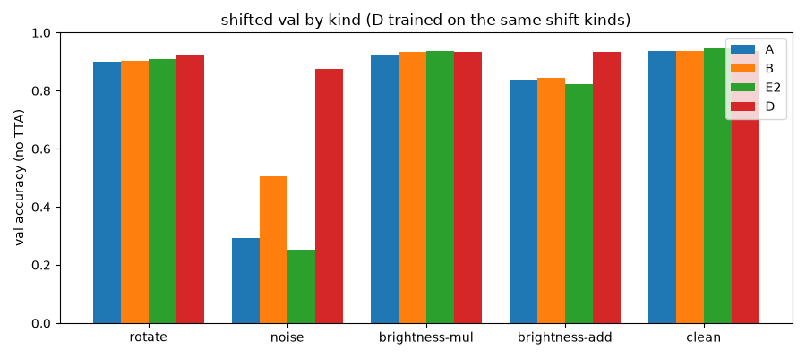 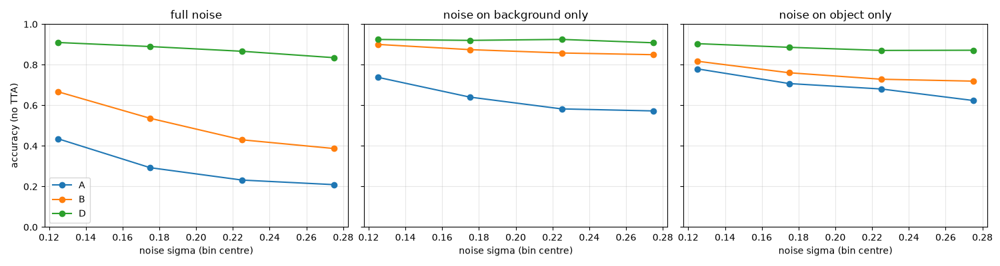

D was trained with augmentation from the same shift families, so shifted val is not an independent check for D. A better clean model is not a more robust one: E2 is best on clean val and worst on noise. The noise failure comes mostly from the clipped noise lifting the all-zero background (docs/robustness.md §2). The students inherit E2's weakness.

### Hidden set

The scope was declared before release: E2, B and D (float + int8) and S0, S1 (int8), all with flip TTA (commits 693f9c2 and ba2ccb9). Run `python -m experiments.hidden_eval PATH` (npz / idx / PNG folder, any image size or channel count; every conversion is logged). It writes `runs/hidden_eval_hidden.json`, a per-model per-class table (`_per_class.md`), a confusion grid (`_confusion.png`), per-image predictions (`_predictions.csv`) and a clean-test-vs-hidden figure (`_vs_test.png`). Then `make_tables` fills the table below.

<!-- table:hidden -->
Format self-test (6,000 shifted-val images saved as npz / idx.gz / PNG): images, labels and every model's predictions identical across formats: **pass**.

_Hidden set not released yet. After `python -m experiments.hidden_eval PATH`, re-run `python -m scripts.make_tables` to fill this table from `runs/hidden_eval_hidden.json`._
<!-- /table:hidden -->

Format self-test figure (shifted val used as a stand-in hidden set): 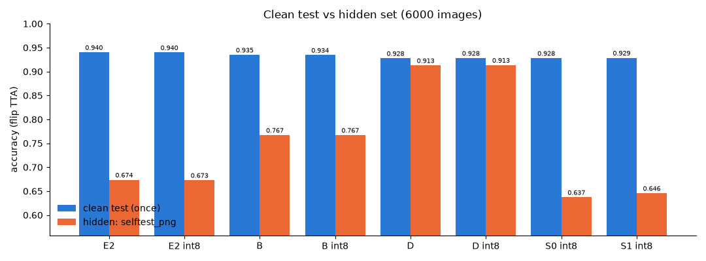

## Knowledge distillation

**Teacher:** E2 (single model), chosen before any distillation run. **Cache:** the teacher's eval-mode logits are precomputed on K = 4 augmented copies of the 54k train split (float16 images, seed 21). Each student epoch draws one random copy per sample, so the teacher never runs inside the training loop. The v1 cache included random erasing, and E2 was only ~87% right on those copies. v1 was therefore used only for the architecture screen, and all student runs use the crop+flip v2 cache.

<!-- table:distill_cache -->
| cache | copies | images / copy | size | build | teacher (E2) acc on copies |
|---|---|---|---|---|---|
| v1 crop+flip+erase (screen only) | 4 | 54,000 | 332 MB | 3.3 min | 0.872–0.877 |
| v2 crop+flip (S0, S1) | 4 | 54,000 | 332 MB | 3.1 min | 0.953–0.954 |
<!-- /table:distill_cache -->

**Student architecture screen** (10 epochs CE each, lr from each candidate's own LR finder). P (plain convs + GAP) was picked by the pre-declared speed tolerance (within 0.3 pt of the best). All three fit the 50 KB int8 budget.

<!-- table:distill_candidates -->
| id | architecture | params | int8 bytes | MACs | s/epoch | 10-ep CE val |
|---|---|---|---|---|---|---|
| P | plain conv 16-24 | 48 | 64, GAP, fc | 42,570 | 43,770 | 6.2M | 67 | 0.9262 |
| DS | stem 32, DS 48 | DS 96, DS 96 | DS 192, GAP, fc | 39,930 | 45,263 | 5.6M | 215 | 0.9268 |
| H | plain 24-32 @28 | DS 64, DS 128 | DS 160, GAP, fc | 42,738 | 47,334 | 8.8M | 168 | 0.9255 |
<!-- /table:distill_candidates -->

**Students** (P, 40 epochs, AdamW + finder lr + CosineWarmup). S0 uses CE on the cache. S1 uses KD with T = 4 and α = 0.9. The final student was selected by **int8 val+TTA**, which picked S0, and only S0 touched test in Phase 6b. S1 is the task's required distilled deliverable. It was tested once in Phase 7 for that purpose only, as pre-registered, and the selection did not change.

<!-- table:distill -->
| student | loss | val | val+TTA | val NLL | ECE | int8 val+TTA | float test | int8 test | train time |
|---|---|---|---|---|---|---|---|---|---|
| S0 (selected) | CE | 0.9320 | 0.9367 | 0.2033 | 0.0212 | 0.9337 | 0.9304 | 0.9281 | 48.1 min |
| S1 (KD deliverable) | KD T=4, α=0.9 | 0.9322 | 0.9337 | 0.1817 | 0.0147 | 0.9323 | 0.9299 | 0.9287 | 51.0 min |
<!-- /table:distill -->

**Honest KD finding.** On the selection metric (val+TTA, float and int8), KD did not beat plain CE. KD did improve val NLL and ECE, and rotation/brightness-add robustness (Robustness table). On test, S1 int8 lands marginally above S0 int8. The gap is a few images, well inside 1 s.e. (≈0.26 pt at n = 10,000), and it did not affect selection, which was fixed on val beforehand. Candidate reasons:
1. *Teacher errors in the cache.* E2 is ~95% right on the augmented copies, so 1 in 20 soft targets points the wrong way, and α = 0.9 trusts them heavily.
2. *Capacity, not labels, is the bottleneck.* A 42k-parameter GAP network underfits relative to the 468k teacher, so softer targets add little information it can use.
3. *TTA interaction.* KD's smoother outputs gain less from flip averaging (S1 TTA gain ≈ ⅓ of S0's), which erases KD's small plain-val advantage.
4. *One T/α setting.* S2 (T = 2) was gated off because S1 already cleared the bar. No T/α sweep was run.

## LR finder and cosine warmup

`optim.lr_finder` (Smith 2017) raises the lr exponentially per batch over one epoch from 1e-6 to 1 and stops when the smoothed loss exceeds 4× its minimum. The rule used is lr = (lr at min smoothed loss) / 10. `CosineWarmup` is a per-batch linear warmup (1 epoch) followed by cosine decay to 0.

<!-- table:lr -->
| finder run | lr at min loss | min / 10 | steepest | used |
|---|---|---|---|---|
| CNN A recipe | 0.0911 | 0.00911 | 0.000152 | min/10 (9.1x the hand-picked 1e-3) |
| student P | 0.572 | 0.0572 | 0.00109 | min/10 |
| student DS | 0.144 | 0.0144 | 0.00291 | min/10 |
| student H | 0.221 | 0.0221 | 0.003 | min/10 |

| change | Δ val+TTA (pt) |
|---|---|
| finder lr, constant (E1 - A) | +0.05 |
| cosine warmup (E2 - E1) | +0.52 |
<!-- /table:lr -->

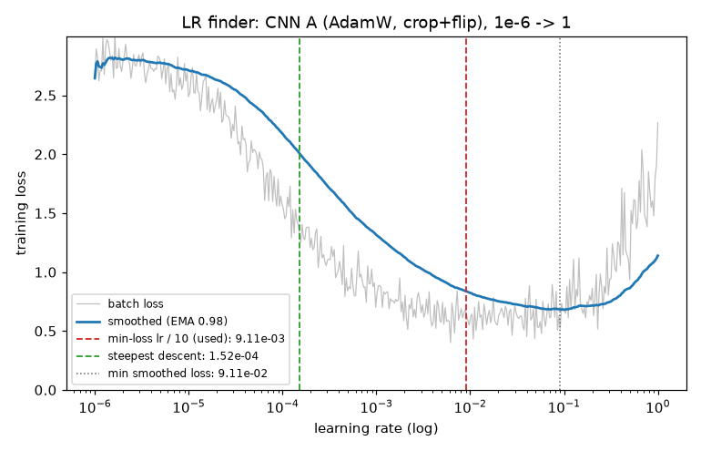

The finder lr alone (E1) barely helps. Combined with the schedule (E2) it is the largest clean gain in the study. The full ablation is in [docs/ablation.md](docs/ablation.md). Δ is in val+TTA points unless the row says shifted / noise:

<!-- table:ablation -->
| model | val | val+TTA | test (once) | ECE | shifted all | noise | params | size KB |
|---|---|---|---|---|---|---|---|---|
| A | 0.9362 | 0.9393 | 0.9325 (no TTA) | 0.0066 | 0.683 | 0.293 | 468,138 | 1831.2 |
| C | 0.9360 | 0.9383 | – | 0.0848 | 0.732 | 0.450 | 468,138 | 1831.2 |
| B | 0.9377 | 0.9398 | 0.9349 | 0.0066 | 0.760 | 0.506 | 468,138 | 1831.2 |
| B int8 | 0.9368 | 0.9387 | 0.9344 | – | 0.758 | 0.502 | 468,138 | 466.9 |
| E1 | 0.9387 | 0.9398 | – | 0.0087 | 0.691 | 0.352 | 468,138 | 1831.2 |
| E2 | 0.9448 | 0.9450 | 0.9403 | 0.0043 | 0.671 | 0.252 | 468,138 | 1831.2 |
| E2 int8 | 0.9435 | 0.9447 | 0.9399 | – | 0.670 | 0.248 | 468,138 | 466.9 |
| D | 0.9360 | 0.9368 | 0.9278 | 0.0129 | 0.910 | 0.875 | 468,138 | 1831.2 |
| D int8 | 0.9358 | 0.9370 | 0.9282 | – | 0.910 | 0.875 | 468,138 | 466.9 |
| S0 | 0.9320 | 0.9367 | 0.9304 | 0.0212 | 0.630 | 0.235 | 42,570 | 167.5 |
| S0 int8 | 0.9267 | 0.9337 | 0.9281 | – | 0.628 | 0.242 | 42,570 | 42.7 |
| S1 | 0.9322 | 0.9337 | 0.9299 | 0.0147 | 0.637 | 0.209 | 42,570 | 167.5 |
| S1 int8 | 0.9280 | 0.9323 | 0.9287 | – | 0.638 | 0.210 | 42,570 | 42.7 |
<!-- /table:ablation -->

<!-- table:deltas -->
| change | Δ (pt) |
|---|---|
| random erasing (B - A) | +0.05 |
| label smoothing (C - B) | -0.15 |
| finder lr, constant (E1 - A) | +0.05 |
| cosine warmup (E2 - E1) | +0.52 |
| shift aug + erase on E2 recipe (D - E2) | -0.82 |
| KD T=4 (S1 - S0) | -0.30 |
| int8 PTQ, E2 (E2 int8 - E2) | -0.03 |
| int8 PTQ, student (S0 int8 - S0) | -0.30 |
| student vs teacher (S0 - E2) | -0.83 |
| shifted overall, shift aug (D - E2) | +23.93 |
| noise, random erasing (B - A) | +21.29 |
<!-- /table:deltas -->

## Evaluation discipline

- **Splits.** 54k train / 6k val (seed 0), fixed in Phase 0. Normalization statistics come from train only. Every choice (lr, epochs, augmentation, calibrator, architecture, KD on/off, final model) was made on val.
- **Test-once guards.** Test numbers live in `runs/test_once.json` (Phase 6b+) or in a per-phase test JSON. Each script refuses to re-evaluate a key that already exists (`distill.once()`, the `cnn test` / `robust select` guards). `distill final` asserts that no other student touched test. Every test evaluation ever run:

<!-- table:test_log -->
| model | test acc | TTA | record |
|---|---|---|---|
| MLP sgd | 0.8880 | no | `runs/mlp_test.json` |
| MLP adam | 0.8916 | no | `runs/mlp_test.json` |
| A (Phase 3) | 0.9325 | no | `runs/cnn_test.json` |
| B (Phase 3b) | 0.9349 | flip | `runs/cnn_ablation.json` |
| B int8 (Phase 4) | 0.9344 | flip | `runs/cnn_b_int8.json` |
| E2 float | 0.9403 | flip | `runs/test_once.json` |
| E2 int8 | 0.9399 | flip | `runs/test_once.json` |
| D float | 0.9278 | flip | `runs/test_once.json` |
| D int8 | 0.9282 | flip | `runs/test_once.json` |
| S0 float | 0.9304 | flip | `runs/test_once.json` |
| S0 int8 | 0.9281 | flip | `runs/test_once.json` |
| S1 float | 0.9299 | flip | `runs/test_once.json` |
| S1 int8 | 0.9287 | flip | `runs/test_once.json` |
<!-- /table:test_log -->

- **The one selection-rule revision.** The Phase 6a rule compared only B vs D, the two robustness candidates, and kept B. That rule could not select E2, which had the best val+TTA of all runs. In Phase 6b the rule was revised to "best val+TTA among all val-evaluated runs", which gives E2. The revision was committed (693f9c2) *before* E2's test set was touched, together with the hidden-set scope and the teacher choice. B's already-reported test result stands as the int8 reference.
- **Mid-run rule changes** (user-directed, each recorded in `docs/PROGRESS.md` before the affected run):
  - the student screen pick became "P if within 0.3 pt of the best" (DS was best by 0.07 pt but ~3× slower);
  - an epoch rule (30 if > 120 s/epoch) was added and not triggered;
  - the KD cache was rebuilt without erasing (v2) after E2 scored only ~87% on v1;
  - the S2 gate was set on S1's int8 val before S2 could run;
  - S1's deliverable test was pre-registered (ba2ccb9) before it was run.
- **Things that didn't work.**
  - *Label smoothing:* lower val+TTA and much worse ECE.
  - *KD accuracy:* no gain on the selection metric (above).
  - *Quantization cost on the small model:* on the 42k-param student int8 costs about 10× more val accuracy than on E2, because a small net has less redundancy to absorb rounding.
  - *Shift augmentation's clean cost:* D buys large shifted gains with a clean-val loss, a trade-off, not a free win.
  - *Integer engine speed in NumPy:* see int8.

Design history and per-phase decisions: [docs/PROGRESS.md](docs/PROGRESS.md).
